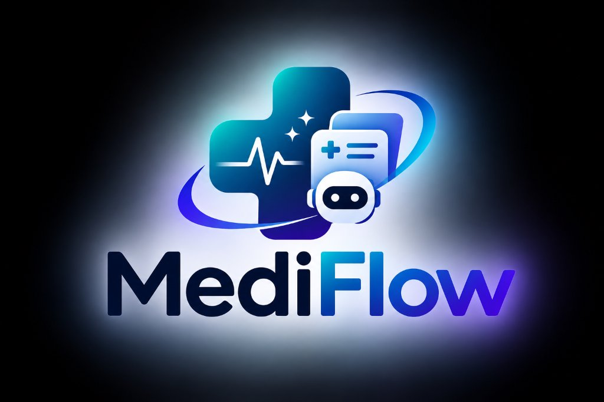

# 🩺 MediFlow
### Evidence-Grounded Longitudinal Health Intelligence & Clinical Diagnostics

An intelligent medical intelligence platform that analyzes comprehensive laboratory blood panels, performs automated biomarker spectrum mapping, and enables evidence-grounded conversational follow-up via a multi-model LLM cascade and contextual RAG.

**Live Application**: [mediflow-health-management.streamlit.app](https://mediflow-health-management.streamlit.app/)

<p align="center">
  
</p>

<p align="center">
  <a href="#-key-features">Key Features</a> •
  <a href="#%EF%B8%8F-system-architecture">System Architecture</a> •
  <a href="#-tech-stack">Tech Stack</a> •
  <a href="#-project-structure">Project Structure</a> •
  <a href="#-getting-started">Getting Started</a> •
  <a href="#-deployment">Deployment</a> •
  <a href="#-team--contributors">Team & Contributors</a>
</p>

---

## 🌟 Key Features

- **Automated Biomarker Spectrum Mapping**:
  - Automatically identifies, extracts, and tags core diagnostic spectra from uploaded PDF reports:
    - Complete Blood Count (CBC)
    - Comprehensive Metabolic Panel (CMP / BMP)
    - Lipid & Cardiovascular Panel
    - Hepatic / Liver Function Panel
    - Thyroid Profile (TSH, Free T3/T4)
- **120B Multi-Model LLM Fallback Cascade**:
  - High-resilience clinical synthesis engine powered by Groq with automated 4-tier model fallback:
    1. **Primary**: `openai/gpt-oss-120b` (Deep clinical synthesis & complex panel correlation)
    2. **Secondary**: `qwen/qwen3.8-27b` (High-efficiency clinical reasoning fallback)
    3. **Tertiary**: `openai/gpt-oss-20b` (Rapid diagnostic assessment)
    4. **Fallback**: `allam-2-7b` (High-availability safety baseline)
- **Evidence-Grounded RAG Follow-Up Q&A**:
  - Semantic vector indexing of extracted patient lab values using LangChain, HuggingFace embeddings (`sentence-transformers/all-MiniLM-L6-v2`), and in-memory FAISS vector storage.
  - Context-bound follow-up chat strictly anchored to the patient's individual biomarker values to eliminate clinical hallucinations.
- **Persistent Authenticated Sessions & RLS Security**:
  - Full user lifecycle with Supabase Auth and PostgreSQL Row-Level Security (RLS).
  - Cryptographic HMAC-SHA256 signed session tokenization (`user_id::refresh_token::signature`) persisted in URL query parameters and browser storage, preventing session loss on browser refreshes (F5).
- **Modern Clinical Dark Design System**:
  - Bespoke Dark Slate (`#0B0F19` / `#1E293B`) & Sky Blue / Clinical Teal (`#38BDF8` / `#2DD4BF`) interface with borderless vector branding, visual report intake indicators, and quota tracking.

---

## ⚙️ System Architecture

```
[Patient / Doctor]
       │
       ▼
[Streamlit Dark Interface] ◄───► [Dual-Layer Session Manager] (HMAC + Supabase Auth)
       │
       ├─────────────────────────────────┐
       ▼                                 ▼
[PDF Ingestion & Text Extraction]   [Clinical Session History & State]
  (PDFPlumber + File Validation)      (Supabase PostgreSQL + RLS)
       │
       ├─────────────────────────────────┬─────────────────────────────────┐
       ▼                                 ▼                                 ▼
[Biomarker Spectrum Detection]    [120B Model Cascade]             [FAISS Vector Store]
  (CBC, Metabolic, Lipid, Hepatic)  (Groq: 120B ➔ 27B ➔ 20B ➔ 7B)    (Sentence-Transformers RAG)
                                         │                                 │
                                         ▼                                 ▼
                             [Primary Clinical Synthesis]     [Evidence-Grounded Follow-Up]
```

---

## 🛠️ Tech Stack

| Layer | Technology |
| :--- | :--- |
| **Frontend Framework** | [Streamlit](https://streamlit.io/) (Dark Slate & Sky Blue/Teal Theme, Custom HTML/CSS) |
| **Language & Runtime** | Python 3.11+ |
| **LLM Inference** | [Groq Cloud](https://groq.com/) Multi-Model Cascade (`gpt-oss-120b`, `qwen3.8-27b`, `gpt-oss-20b`, `allam-2-7b`) |
| **Embeddings & Vector Store** | LangChain, HuggingFace (`all-MiniLM-L6-v2`), [FAISS](https://github.com/facebookresearch/faiss) (CPU) |
| **Database & Auth** | [Supabase](https://supabase.com/) (PostgreSQL with Row-Level Security, Gotrue Auth) |
| **Document Processing** | PDFPlumber, filetype |
| **Security & Session** | Cryptographic HMAC-SHA256 tokenization with Supabase refresh token rotation |

---

## 📁 Project Structure

```
mediflow-health-agent/
├── assets/
│   ├── mediflow_logo.png       # Official borderless MediFlow brand logo
│   ├── mediflow_icon.png       # Square icon mark for badges and avatars
│   └── favicon.png             # 64x64 browser tab favicon
├── src/
│   ├── main.py                 # Application entrypoint & top-level layout
│   ├── agents/
│   │   ├── analysis_agent.py   # Clinical intake, validation, and synthesis agent
│   │   ├── chat_agent.py       # RAG pipeline with FAISS vector store
│   │   └── model_manager.py   # 4-tier Groq model fallback cascade
│   ├── auth/
│   │   ├── auth_service.py     # Supabase Auth client, session CRUD, and auto-provisioning
│   │   └── session_manager.py # Cryptographic token handling & reload persistence
│   ├── components/
│   │   ├── analysis_form.py    # Report upload, biomarker spectrum tags, and intake form
│   │   ├── auth_pages.py       # Frosted glass Login & Registration screens
│   │   ├── footer.py           # Team attribution footer
│   │   └── sidebar.py          # Diagnostic history list, quota meter, and logout
│   ├── config/
│   │   ├── app_config.py       # App constants, design tokens, and cached asset loaders
│   │   ├── prompts.py          # Clinical specialist prompts & diagnosis schemas
│   │   └── sample_data.py      # Standard reference blood panel for demo testing
│   ├── services/
│   │   └── ai_service.py       # AI orchestration & vector store caching
│   └── utils/
│       ├── pdf_extractor.py   # PDF text extraction and sanity checking
│       └── validators.py       # Credential and document validation utilities
├── public/
│   └── db/
│       ├── script.sql          # Supabase SQL schema (users, chat_sessions, chat_messages)
│       └── schema.png          # Database ER diagram
├── requirements.txt            # Python dependencies
├── packages.txt                # Linux OS dependencies (libgomp1)
└── README.md
```

---

## 🚀 Getting Started

### Prerequisites

- Python 3.10 or 3.11
- A free [Supabase](https://supabase.com/) project
- A free [Groq Cloud](https://console.groq.com/) API key

### 1. Clone the Repository

```bash
git clone https://github.com/astik77/mediflow-health-agent.git
cd mediflow-health-agent
```

### 2. Install Dependencies

```bash
pip install -r requirements.txt
```

### 3. Configure Secrets

Create a file named `.streamlit/secrets.toml` in the repository root:

```toml
SUPABASE_URL = "https://your-project-id.supabase.co"
SUPABASE_KEY = "your-supabase-publishable-key"
GROQ_API_KEY = "gsk_your_groq_api_key"
```

### 4. Database Setup

Run the SQL script located at `public/db/script.sql` in the Supabase SQL Editor to provision the required tables (`users`, `chat_sessions`, `chat_messages`) and Row-Level Security policies.

*(Optional: Disable email confirmation in Supabase Dashboard: **Authentication → Providers → Email → Confirm email** for instant testing).*

### 5. Launch Application

```bash
streamlit run src/main.py
```

The application will launch on `http://localhost:8501`.

---

## 🌐 Deployment

MediFlow is continuously deployed via Git CI/CD on **Streamlit Community Cloud**:

- **Live URL**: [https://mediflow-health-management.streamlit.app/](https://mediflow-health-management.streamlit.app/)
- Any commit pushed to the `main` branch automatically triggers zero-downtime hot re-deployment.

---

## 👥 Team & Contributors

This project is developed as an academic capstone / major project by:

| Contributor | Role | Key Contributions |
| :--- | :--- | :--- |
| **Astik Saini** | **AI & LLM Pipeline Architect** | Architected the 4-tier model cascade (`gpt-oss-120b`, `qwen3.8-27b`, `gpt-oss-20b`, `allam-2-7b`) on Groq with automated fallback resilience; designed clinical specialist prompts, diagnostic schemas, and differential synthesis pipelines. |
| **Meet Goyal** | **Cloud Database & Security Architect** | Designed Supabase PostgreSQL architecture and Row-Level Security (RLS) policies; engineered cryptographic HMAC-SHA256 session tokenization and auto-refresh mechanisms for zero-drop reload persistence; managed cloud deployment CI/CD. |
| **Gaurav Singh** | **Clinical RAG & Vector Systems Engineer** | Implemented the medical document extraction engine with biomarker spectrum mapping (CBC, Metabolic, Lipid, Hepatic, Thyroid); constructed the LangChain + FAISS semantic vector retrieval pipeline using `all-MiniLM-L6-v2` embeddings for context-grounded Q&A. |
| **Shubham Kumar** | **Full-Stack & UI/UX Systems Engineer** | Engineered the modern Streamlit interface with a clinical Dark Slate & Sky Blue/Teal design system; built responsive component layouts, live quota tracking indicators, and integrated official borderless vector branding (logo, favicon, and badges). |
